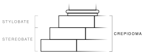

<div align="center">

# Crepidoma

**The stepped base every Levia Labs pillar project stands on.**

[](https://github.com/Levia-Labs/Crepidoma/actions/workflows/validate.yml)
[](LICENSE)
[](plugins/crepidoma/README.md)

<br>
<sub>Image: "<a href="https://commons.wikimedia.org/wiki/File:Crepidoma-stereobate-stylobate.svg">Crepidoma-stereobate-stylobate.svg</a>" by Gleb713, <a href="https://creativecommons.org/licenses/by-sa/4.0/">CC BY-SA 4.0</a>, via Wikimedia Commons; cropped, relabelled with a pillar bracket, white background added.</sub>

</div>

> In classical Greek architecture, crepidoma is the foundation of one or more steps on which the superstructure of a building is erected.
>
> <p align="right">— <a href="https://en.wikipedia.org/wiki/Crepidoma">Crepidoma, Wikipedia</a></p>

## Why

- One source for LLM directives, agents, hooks, gates, configs, Taskfiles and process ADRs.
- Pillars **link** Crepidoma; nothing is copied, nothing drifts.
- Every turn is a tool call with a small receipt: fewer tokens, fewer surprises.

## Quick start

1. **Plugin** in the pillar's `.claude/settings.json`:

   ```json
   {
     "extraKnownMarketplaces": {
       "levia-labs": {
         "source": { "source": "github", "repo": "Levia-Labs/Crepidoma", "ref": "main" }
       }
     },
     "enabledPlugins": { "crepidoma@levia-labs": true }
   }
   ```

   ```sh
   claude plugin install crepidoma@levia-labs --scope project
   ```

2. **Taskfiles and configs** as a submodule:

   ```sh
   git submodule add -b main https://github.com/Levia-Labs/Crepidoma .crepidoma
   ```

   ```yaml
   includes:
     claude: .crepidoma/taskfiles/claude
     repo: .crepidoma/taskfiles/repo
     git: .crepidoma/taskfiles/git
     quality: .crepidoma/taskfiles/quality
   ```

3. **Commit gates** in `.pre-commit-config.yaml`:

   ```yaml
   repos:
     - repo: https://github.com/Levia-Labs/Crepidoma
       rev: main
       hooks:
         - id: crepidoma-scrub
         - id: crepidoma-long-files
   ```

- Full steps: [docs/migration.md](docs/migration.md)
- Copy-once files: [templates/](templates/README.md)
- Or let Claude do it: run the `migrate-pillar` skill from a Crepidoma session

## What you get

| Layer          | Highlights                                                                                                                                                                                                          |
| -------------- | ------------------------------------------------------------------------------------------------------------------------------------------------------------------------------------------------------------------- |
| **Directives** | Communication style with absolute mode, tool-first loop, conventions, model tiers, shell and safety                                                                                                                 |
| **Models**     | Opus orchestrates · Sonnet works · Haiku reads, greps and indexes                                                                                                                                                   |
| **Hooks**      | Compact subagent harness · raw-read guard · subagent policy and git guard · stop gate                                                                                                                               |
| **Agents**     | auditor · csharp-reviewer · diff-reviewer · docs-syncer · gate-fixer · implementer · integrator · pillar-migrator · python-reviewer · rule-smith · scout · security-reviewer · todo-triage · toolsmith · translator |
| **Skills**     | `docs-sweep` · `migrate-pillar` · `python-patterns` · `python-testing`                                                                                                                                              |
| **Tasks**      | `claude` · `repo` · `todo` · `git` · `graph` · `test` · `quality` · `security` · `ci` · `lint` · `setup` · `rtk`                                                                                                    |
| **Configs**    | ruff · prettier · eslint · tsconfig · pyright · yamllint · ast-grep · semgrep · gitleaks · zizmor · hadolint                                                                                                        |
| **Decisions**  | [ADRs 0001–0009](docs/adr/README.md)                                                                                                                                                                                |

## Repository map

- [`plugins/crepidoma/`](plugins/crepidoma/README.md) - the Claude Code plugin
- [`taskfiles/`](taskfiles/README.md) - shared task namespaces
- [`configs/`](configs/README.md) - shared lint, format and security configs
- [`templates/`](templates/README.md) - files a pillar copies once
- [`tools/`](tools/README.md) - scrub, ratchet, drift, denylist, release, folder READMEs
- [`docs/`](docs/README.md) - guides, ADRs, design history

## Working on Crepidoma

```sh
task setup      # uv sync + git hooks
task validate   # everything CI runs
task --list     # every task
```

- Every commit runs the gates, including `crepidoma-scrub` (no local paths, emails, tokens or private names: the repo is public).
- Every folder has a README; `task docs:readmes` refreshes them and a commit hook keeps them current.

## License

- Code and docs: [MIT](LICENSE)
- Header image: CC BY-SA 4.0, credited above
